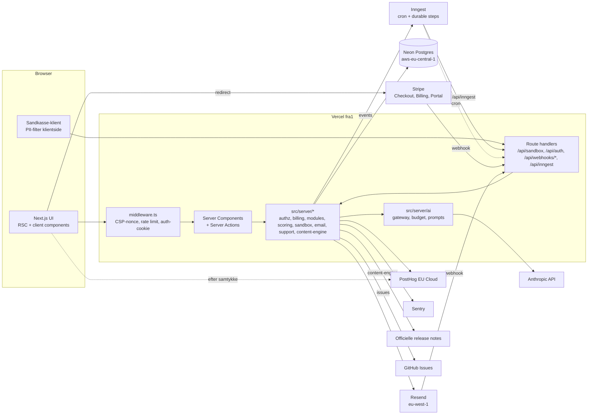

# 02 — Arkitektur

> Kanonisk grundlag: `docs/00-beslutninger.md` (§ 10 går forud), `CLAUDE.md`. Datamodel: `docs/03-datamodel.md` + `prisma/schema.prisma`. Sandkasse: `docs/04-sandkasse.md`. Indholdsmotor: `docs/06-indholdsmotor.md`. Betaling: `docs/07-betaling.md`. Env: `.env.example`.
> Stack verificeret 12. okt 2026 — se § 12. Verificér versioner igen ved opstart af hver milestone.

## 1. Overblik

Én Next.js-app (App Router) på Vercel i `fra1`, én Postgres på Neon (`aws-eu-central-1`), baggrundsjobs i Inngest. Alle LLM-kald går gennem én gateway (`src/server/ai/`). Al persondata ligger i EU.



Principper:
- **Server-first.** Domænelogik kun i `src/server/` (importerer `server-only`). Komponenter kalder server actions; ingen forretningslogik i komponenter.
- **Én vej ind pr. side-effekt:** LLM → `src/server/ai/gateway.ts`; email → `src/server/email/send.ts` (samtykke-gate indbygget); Stripe-status → kun webhook-handler skriver `Subscription`.
- **Data er config:** spor, skins, planer/priser, lofter, feature-flags ligger i DB/config, aldrig i komponenter.
- **Sandkassen taler kun med egen API + Anthropic (via gateway).** Ingen rigtige tredjepartstjenester.

## 2. Mappestruktur

```
greb/
├─ prisma/                    schema.prisma, migrations/, seed.ts (idempotent)
├─ prisma.config.ts           Prisma 7: datasource-URL (DATABASE_URL_UNPOOLED) + seed-kommando
├─ content/
│  ├─ schema/                 module.schema.json (B), sandbox-event.schema.json (genereres fra Zod)
│  ├─ modules/                *.json (CORE/FEATURE/ROLE; NEWS kommer fra DB)
│  ├─ sandbox-world/          Nordlys Logistik: company, employees, mail, calendar, files, crm, budget (+ world.version)
│  ├─ sandbox-skins/          chatgpt.json, copilot.json, claude.json, (gemini.json fase 2)
│  ├─ features/registry.json  feature-registry (06)
│  ├─ sources.json            ContentSource-seed (06)
│  ├─ help/                   hjælpecenter-artikler (MD) til supportagent
│  └─ curriculum.md
├─ src/
│  ├─ app/
│  │  ├─ (marketing)/         landingsside, offentlig niveautest, /certifikat/[id] verifikation, /fortryd-aftale, /afmeld
│  │  ├─ (auth)/              login, magic-link-landing, invitation accept
│  │  ├─ (learner)/           plan, modul-afspiller, sandkasse, certifikater, konto, "Fortryd aftale", opsig
│  │  ├─ (org-admin)/         dashboard, medarbejdere, invitationer, rapport, abonnement
│  │  ├─ (owner)/admin/       GREB_ADMIN: content review, kill switches, forbrug, eskalationer
│  │  └─ api/
│  │     ├─ auth/[...all]/    Better Auth handler
│  │     ├─ sandbox/[sessionId]/chat/   streaming chat (SSE)
│  │     ├─ support/chat/     supportagent (streaming)
│  │     ├─ webhooks/stripe/  + webhooks/resend/
│  │     ├─ inngest/          Inngest serve()
│  │     └─ health/           liveness + DB-ping
│  ├─ server/
│  │  ├─ auth/                better-auth.ts (config), authz.ts, scope.ts (org-scoped Prisma-extension)
│  │  ├─ db.ts                PrismaClient (driver adapter, global omit af prompt-tekst)
│  │  ├─ ai/                  client.ts, models.ts, gateway.ts, budget.ts, pricing.ts, prompts/<key>.v<n>.ts, registry.ts
│  │  ├─ sandbox/             world.ts (loader), reducer.ts, events.ts (Zod), tools.ts, assertions.ts, pii.ts (server-gate)
│  │  ├─ modules/             loader, plan-generator, monthly-cycle
│  │  ├─ scoring/             score.ts, prompt-task-grader.ts, deterministic-checks.ts
│  │  ├─ billing/             plans.ts, checkout.ts, webhook.ts, entitlements.ts, withdrawal.ts, vat.ts
│  │  ├─ email/               send.ts, consent.ts (gate), templates/{service,marketing}/
│  │  ├─ support/             agent.ts, tools.ts (org-scopede), escalation.ts
│  │  ├─ content-engine/      fetch, snapshot, diff, classify, draft, verify, publish, banned-claims.ts
│  │  ├─ certificates/        pdf.ts, verify.ts
│  │  ├─ reports/             org-report csv/pdf
│  │  ├─ security/            rate-limit.ts, csp.ts, webhook-verify.ts
│  │  ├─ audit/               actions.ts (typed union), log.ts
│  │  ├─ observability/       logger.ts, analytics.ts (PostHog server), sentry.ts
│  │  └─ jobs/                inngest client + alle funktioner (én fil pr. job, se § 5)
│  ├─ lib/                    env.ts (Zod, server/klient-split), pii/ (delt regex + Luhn/mod97), i18n/, zod-schemas/,
│  │                          config/ (plans.ts jf. 07, limits.ts, flags.ts — defaults; DB overstyrer)
│  ├─ components/             ui/ (shadcn-primitiver), sandbox/, player/, admin/
│  ├─ generated/prisma/       Prisma-klient (output, git-ignored)
│  └─ styles/tokens.css       ENESTE sted for design-tokens
├─ tests/                     unit/, integration/, e2e/, fixtures/ (inkl. release-notes-fixtures, LLM-mocks)
├─ middleware.ts
└─ vercel.json                { "regions": ["fra1"] } + evt. maxDuration pr. route
```

## 3. Autentificering og organisationer

- **Better Auth** med Prisma-adapter (`better-auth/adapters/prisma`, provider `postgresql`). Login: magic link (mail via `src/server/email/send.ts`, kategori `SERVICE`), Microsoft Entra ID (`tenantId: "common"` så alle arbejds-/skolekonti kan logge ind; `prompt: "select_account"`), Google.
- **Organization-plugin** (`member`-tabellen omdøbes til `membership`; roller `OWNER|ADMIN|LEARNER`, `creatorRole: "OWNER"`; én rolle pr. medlem — ingen kommaseparerede roller). MindForwards ekstra felter på `Organization`/`Membership` erklæres som `additionalFields`.
- **twoFactor-plugin** kun påkrævet for `PlatformRole.GREB_ADMIN`.
- B2C-signup: hook `user.create.after` opretter `Organization(type=PERSONAL, seatLimit=1)` + `Membership(OWNER)` i samme transaktion.
- `session.activeOrganizationId` styrer kontekst. Bruger med flere orgs vælger i UI; server validerer altid medlemskab.
- Feltliste for auth-tabeller er verificeret mod Better Auths docs 12. okt 2026 — kør `npx auth@latest generate` i M1 og diff mod `prisma/schema.prisma` (TODO i skemaet).

## 4. Request-flows

### 4.1 Sandkasse-chat (M3)
1. Klient: bruger skriver → `src/lib/pii` kører lokalt. **BLOCK** → beskeden sendes ikke; **WARN** → modal (ret / "Det er fiktivt").
2. `POST /api/sandbox/{sessionId}/chat` (Zod body: `{ message, clientPiiOverride?, stepId? }`).
3. `requireUser()` → `SandboxSession` hentes med `userId` + `organizationId` i where (ejer-tjek) → status `ACTIVE`.
4. Rate limit (`sandbox-chat`: 10/min, 200/døgn pr. bruger) → 429 med dansk besked.
5. **Server-PII-gate** (samme regler, autoritativ). BLOCK → `SandboxEvent(PII_BLOCKED, {kinds})`, intet LLM-kald, 422.
6. `gateway.call({ feature: SANDBOX_CHAT, promptKey: "sandbox-chat", ... })`: budget-tjek (globalt + dagligt pr. bruger) → byg request (cached system-prompt + verdensresumé + værktøjer for forbundne connectors) → stream.
7. Værktøjskald fra modellen udføres i `src/server/sandbox/tools.ts` mod sessionens state (seed + overlay), aldrig mod eksterne systemer; maks 6 værktøjsrunder pr. svar.
8. Events: `CHAT_MESSAGE_SENT` → (`TOOL_CALL_EXECUTED`)* → `CHAT_RESPONSE_RECEIVED` (server tildeler `seq`; fritekst i `contentText`).
9. `AiCall` + `AiUsageDaily` + `BudgetMonth` opdateres atomisk efter svaret. Svar mærkes "Øvemodel" i UI.

### 4.2 Bedømmelse (M4)
1. Server action `submitStep(attemptId, stepId, answer)` → `requireUser()` + ejer-tjek på `Attempt`.
2. Trin-type-dispatch i `src/server/scoring/`:
   - `QUIZ`/`JUDGMENT`/`SPOT_ERROR`: deterministisk mod modul-JSON.
   - `CLICK_TASK`: `assertions.ts` matcher `SandboxEvent`s i sessionen med `seq` > trinnets start-seq; match → `matchedSandboxEventId`.
   - `PROMPT_TASK`: PII-gate → deterministiske checks (længde, påkrævede elementer, forbudt indhold) — fejler de, ingen LLM. Ellers `gateway.call({ feature: GRADE_PROMPT_TASK, promptKey: "grade-prompt-task", temperature: 0, tool-forced output })` → Zod-parse af rubric-svar. Ugyldigt output → 1 retry → `GradingStatus.ERROR` (aldrig 0 point) + Inngest-retry.
3. Point minus hint-straf (trin 3 = 0 point) → `StepResult` (+ `rubricVersion`, `modelId`, `promptVersion`).
4. Ved sidste trin: `Attempt` afsluttes; ≥ 80 % og ingen must-pass-fejl → bestået; `Assignment.bestScorePct` opdateres hvis bedre; evt. event `certificate/check`.

### 4.3 Checkout + webhook (M6)
1. Server action `startCheckout(planKey, seats?)` → `requireMembership(orgId, [OWNER])` → plan fra `src/lib/config/plans.ts` → B2C: validér at begge checkbokse er afkrydset → **før betaling** gem `ConsentRecord` × 2 (`IMMEDIATE_ACCESS_REQUEST`, `WITHDRAWAL_LOSS_ACK`; `textVersion`, `textHash`, IP, user-agent, `checkoutSessionId`) → Checkout Session (kort, `client_reference_id = orgId`, idempotency-key `checkout:{orgId}:{nonce}`). Detaljer: `docs/07-betaling.md` § 8.
2. `POST /api/webhooks/stripe`: rå body → `stripe.webhooks.constructEvent` (signatur) → `WebhookEvent` upsert på `(STRIPE, event.id)` (audit + dedup; 07 er state-baseret, så tabellen er et ekstra værn) → send Inngest-event `stripe/event.received` → 200.
3. Håndtér `checkout.session.completed`, `customer.subscription.created|updated|deleted`, `invoice.paid|payment_failed`, `customer.subscription.trial_will_end`: hent subscription fra Stripe (ikke stol på event-snapshot) → upsert `Subscription` hvis `event.created ≥ lastStripeEventAt` → `Organization.seatLimit = quantity` → `AuditLog`.
4. Webhook kopierer erklæringstidspunkter + tekstversion fra `ConsentRecord` til `Subscription` (`immediateAccessConsentAt`, `withdrawalWaiverAcknowledgedAt`, `withdrawalConsentTextVersion`, `withdrawalDeadlineAt`). B2C: event `billing/order.confirmed` → ordrebekræftelse (varigt medium) → `orderConfirmationEmailMessageId`.
5. "Fortryd aftale": formular → "Bekræft fortrydelse" → `WithdrawalRequest(submittedAt=now)` + `AuditLog(CONTRACT_WITHDRAWAL_REQUESTED)` → kvittering (side + mail) med dato/tid → `billing/withdrawal.process` (annullér + refusion, `docs/07-betaling.md` § 8.6).

### 4.4 Invitation (M1 email, M7 link/domæne)
1. `requireMembership(orgId, [OWNER, ADMIN])` → seat-tjek: aktive `Membership` + åbne `Invitation` ≤ `seatLimit` → ellers afvis med forklaring.
2. Better Auth `organization.inviteMember` → `Invitation` → SERVICE-mail via `send.ts` (idempotency `invite:{invitationId}`).
3. Modtager klikker → login (magic link/SSO) → accept → `Membership(LEARNER)` → `AuditLog(MEMBER_JOINED)`.
4. Link-join: hash af token på `Organization.joinLinkTokenHash`; domæne-join kun hvis `domainVerifiedAt` (DNS TXT med `domainVerificationToken`) og brugerens email er verificeret på det domæne.

### 4.5 Indholdspipeline (M9)
Se `docs/06-indholdsmotor.md`. Arkitektonisk: Inngest cron fan-out → én funktion pr. kilde med `step.run` pr. trin → LLM via gateway (`CONTENT_*`-features, eget delbudget `BudgetScope.CONTENT_ENGINE`) → `ModuleVersion` → publiceringspolitik (compare-and-set på `Module.publishedVersionId`).

## 5. Baggrundsjobs (Inngest)

Alle i `src/server/jobs/`. Cron i `TZ=Europe/Copenhagen` (undgå 02:00–03:00 pga. sommertid). Default: 3 retries med eksponentiel backoff (sæt eksplicit — Inngests default er ikke verificeret). Hvert job: `step.run` pr. side-effekt, idempotency-nøgle, struktureret log, Sentry ved endelig fejl.

| Funktion | Trigger | Idempotency-nøgle | Retries | Milestone |
|---|---|---|---|---|
| `content.daily-fanout` | cron `15 5 * * *` | `daily:{yyyy-mm-dd}` | 3 | M9 |
| `content.source-run` | event `content/source.run` | `{sourceId}:{yyyy-mm-dd}` (+ `PipelineRun.idempotencyKey`) | 3 (fetch-backoff i 06) | M9 |
| `content.change-process` | event `content/change.created` | `{changeEventId}` | 2 | M9 |
| `content.freshness-audit` | cron `0 4 * * 0` | `freshness:{isoWeek}` | 2 | M9 |
| `content.feature-retire` | event `content/feature.retire-date` (planlagt `ts`) | `{featureId}:{date}` | 3 | M9 |
| `retention.purge-prompt-text` | cron `30 3 * * *` | `purge-prompt:{date}` | 5 | M4 |
| `retention.purge-misc` | cron `45 3 * * *` | `purge-misc:{date}` | 5 | M4/M10 |
| `gdpr.erase-user` | event `user/erasure.requested` | `{userId}` | 5 | M10 |
| `monthly.compose-cycles` | cron `30 0 1 * *` | `cycle:{month}:{trackId}` | 3 | M8 |
| `monthly.assign-users` | event `monthly/cycle.composed` (batch pr. 500) | `{cycleId}:{userId}:{orgId}` (unik i DB) | 3 | M8 |
| `monthly.reminders` | cron `45 8 * * *` | `reminder:{monthlyAssignmentId}:{1\|14\|25}` (`EmailMessage.idempotencyKey`) | 3 | M8 |
| `email.send` | event `email/send.requested` | `EmailMessage.idempotencyKey` | 4 | M1 |
| `consent.expire-unconfirmed` | cron `0 4 * * *` | `consent-expire:{date}` | 3 | M5 |
| `billing.order-confirmation` | event `billing/order.confirmed` | `order:{stripeSubscriptionId}` | 5 | M6 |
| `billing.withdrawal-process` | event `billing/withdrawal.submitted` (kvittering + annullering + refusion) | `{withdrawalRequestId}` | 5 | M6 |
| `billing.stripe-event` | event `stripe/event.received` (webhook svarer 200 hurtigt, arbejdet sker her) | Stripe `event.id` | 5 | M6 |
| `certificate.issue` | event `certificate/check` | `{userId}:{orgId}:{trackId}:{level}` (unik i DB) | 3 | M7 |
| `report.generate` | event `report/requested` | `{orgId}:{requestId}` | 2 | M7 |
| `grading.retry` | event `grading/failed` | `{stepResultId}:{n}` | 3 | M4 |
| `ai.budget-watch` | cron `5 * * * *` | CAS på `BudgetMonth.alert80SentAt/alert100SentAt` | 3 | M10 |
| `sandbox.expire-sessions` | cron `15 4 * * *` | `sbx-expire:{date}` | 3 | M3 |
| `digest.owner-daily` | cron `0 7 * * *` (jf. `docs/08-support.md`) | `digest:{date}` | 3 | M10 |

`retention.purge-misc`: `SourceSnapshot.raw` > 90 d, `WebhookEvent.payload` > 30 d, `AiCall` > 13 mdr., udløbne `Verification`/`Session`, lukkede sandkasser > 30 d, `SupportMessage.content` > 12 mdr. (se 03 for fuld matrix).

## 6. AI-lag (`src/server/ai/`)

**Kun gatewayen må importere Anthropic-SDK'et** (ESLint `no-restricted-imports` + test).

| Fil | Ansvar |
|---|---|
| `client.ts` | Anthropic SDK-singleton, `ANTHROPIC_API_KEY`, standard-timeout. |
| `models.ts` | `feature → { model, fallbackModel, maxTokens, temperature, timeoutMs }` fra env/config. Model-id'er findes KUN her. |
| `prompts/<key>.v<n>.ts` | Versionerede prompts: `{ key, version, system, tools?, outputSchema? (Zod), cache: true }`. Ændring = ny fil (v2), gammel bevares. |
| `registry.ts` | Aktiv version pr. key (config) → muliggør rollback af prompt uden deploy. |
| `gateway.ts` | `call()` / `stream()` — den eneste indgang (pipeline nedenfor). |
| `budget.ts` | Dagligt loft pr. bruger, globalt månedsloft, degraderingsniveau. |
| `pricing.ts` | Tokenpriser pr. model (USD/MTok) + `AI_USD_DKK_RATE` → `costDkk`. Verificér priser på anthropic.com ved opstart. |

**Modelvalg (default lille model):**

| Feature | Model-env | Temp | maxTokens | Timeout |
|---|---|---|---|---|
| `SANDBOX_CHAT`, `SANDBOX_AGENT` | `AI_MODEL_DEFAULT` | 0,7 | 800 | 30 s (stream) |
| `GRADE_PROMPT_TASK` | `AI_MODEL_GRADER` (default = `AI_MODEL_DEFAULT`) | 0 | 600 | 20 s |
| `SUPPORT_AGENT` | `SUPPORT_MODEL` (lille; default = `AI_MODEL_DEFAULT`) | 0,2 | 800 | 30 s |
| `CONTENT_CLASSIFY`, `CONTENT_DRAFT` | `CONTENT_CLASSIFY_MODEL`, `CONTENT_DRAFT_MODEL` (lille) | 0 | 1.500 / 3.000 | 90 s |
| `CONTENT_VERIFY` | `CONTENT_VERIFY_MODEL` (større model tilladt, ≠ draft) | 0 | 3.000 | 120 s |

**Gateway-pipeline (rækkefølge):**
1. Zod-validér input; slå prompt op i registry.
2. Kill switch `AI_ENABLED` (FeatureFlag) og degraderingsniveau.
3. Rate limit pr. feature (§ 7).
4. PII-gate for brugerinput (`SANDBOX_*`, `GRADE_PROMPT_TASK`, `SUPPORT_AGENT`).
5. **Dagligt loft pr. bruger** (`AiUsageDaily`, Europe/Copenhagen-døgn): `AI_USER_DAILY_TOKEN_CAP` (chat + agent + support) og `AI_USER_DAILY_GRADING_CAP` (antal bedømmelser — separat, så en bruger aldrig sidder fast i et modul pga. chat). Overskredet → `BLOCKED_USER_CAP` + venlig besked ("Du har brugt dagens øvekvote. Den nulstilles kl. 00.").
6. **Prompt caching:** `cache_control` på system-prompt, værktøjsdefinitioner og Nordlys-verdensresumé/rubric (statisk prefix først, variabelt indhold sidst). Minimumslængde for caching afhænger af model — verificér; padding undgås, hellere sammenlæg statisk kontekst.
7. Kald med `AbortController`-timeout. Retry kun på 429/5xx/overloaded: 2 forsøg, backoff 0,5 s → 2 s med jitter, respektér `retry-after`.
8. **Fallback:** efter mislykkede retries → `fallbackModel` én gang (`status=FALLBACK`). Grader: hellere `GradingStatus.ERROR` + `grading.retry`-job end en anden rubric-model (konsistens). Support: fallback til hjælpecenter-søgning + eskalationsformular.
9. Struktureret output: tvungen tool-use med JSON-schema fra Zod → `safeParse` → ugyldigt = 1 retry med fejlbesked, ellers kontrolleret fejl.
10. **Forbrugslog pr. kald:** `AiCall` (bruger, org, feature, model, promptKey/version, tokens inkl. cache read/write, `costDkk`, latency, status) — aldrig prompt/svar-tekst. Atomisk `upsert … increment` på `AiUsageDaily` og `BudgetMonth(GLOBAL_AI)`.

**Globalt månedsloft** (`AI_GLOBAL_MONTHLY_BUDGET_DKK`, mål 5.000–10.000 kr/md ved 10.000 brugere):

| Niveau | Effekt |
|---|---|
| ≥ 80 % | Én alarm pr. måned (mail til ejer + Sentry), CAS på `alert80SentAt`. Ingen brugereffekt. |
| ≥ 95 % | `AI_DEGRADED_MODE`: chat `maxTokens` 400, historik 6 ture, indholdsmotor pauser draft/verify. |
| 100 % | Nye `SANDBOX_*`-kald blokeres pænt ("Øvemodellen holder pause — øvelser uden chat virker stadig"). `PROMPT_TASK`: deterministiske checks kører; rubric-del sættes `PENDING` og bedømmes, når loftet løftes/ny måned. Support → hjælpecenter + eskalation. READ/QUIZ/CLICK_TASK/JUDGMENT virker altid. |

Indholdsmotoren har eget delbudget (`CONTENT_MONTHLY_BUDGET_DKK`) inden for det globale.

## 7. Sikkerhed

**Authz-helpers** (`src/server/auth/authz.ts`) — kaldes først i HVER server action og route handler:
- `requireUser()` → `{ user, session }` eller 401/redirect.
- `requireMembership(orgId, roles[])` → `Membership` (ikke deaktiveret) eller 403.
- `requireOrgAdmin(orgId)` = `requireMembership(orgId, [OWNER, ADMIN])`.
- `requirePlatformAdmin()` → `PlatformRole.GREB_ADMIN` + 2FA-verificeret session.
- `requireOwnResource(model, id)` for lærerens egne `Attempt`/`SandboxSession`/`StepResult`.
- Håndhævelse: test der scanner `src/app/**/actions.ts` og `src/app/api/**/route.ts` for authz-kald (undtagelser på eksplicit allowlist: webhooks, health, offentlig niveautest, certifikat-verifikation, Better Auth).

**Org-scoping:** `scope.ts` eksporterer `forOrg(orgId)` = Prisma client extension, der injicerer `organizationId` i `where`/`data` for org-ejede modeller. Direkte `db.<orgModel>` uden scope er forbudt i `src/server/**` undtagen jobs (lint-regel). Cross-org-test pr. ny action.

**Prompt-tekst-privatliv:** `PrismaClient` oprettes med global `omit` for `StepResult.promptText`, `StepResult.aiFeedback`, `SandboxEvent.contentText`. Kun `src/server/scoring/owner-feedback.ts` og sandkassens egen session-loader slår dem til — og kun efter `requireOwnResource`. Admin-/rapport-/support-queries kan derfor ikke lække dem ved et uheld (test).

**Rate limits** (`src/server/security/rate-limit.ts`, Postgres-tæller i `RateLimit`; Better Auth bruger samme tabel):

| Nøgle | Grænse |
|---|---|
| auth magic link | 5 / 15 min pr. email + 20 / time pr. IP |
| `sandbox-chat` | 10 / min, 200 / døgn pr. bruger |
| `grade-prompt-task` | 20 / min pr. bruger |
| `support-chat` | 6 / min, 60 / døgn pr. bruger |
| offentlig niveautest (start/svar) | 10 / time pr. IP + bot-beskyttelse (honeypot + tidsgrænse; Turnstile kun hvis misbrug) |
| samtykke-tilmelding | 5 / time pr. IP og pr. email |
| "Fortryd aftale"-formular | 5 / time pr. IP |

**CSP** (middleware med nonce): `default-src 'self'; script-src 'self' 'nonce-…' 'strict-dynamic'; connect-src 'self' <POSTHOG_HOST> <SENTRY_INGEST>; img-src 'self' data: blob:; style-src 'self' 'unsafe-inline'` (verificér om Tailwind/shadcn kræver det); `frame-ancestors 'none'; form-action 'self' https://checkout.stripe.com; base-uri 'self'`. Stripe Checkout er redirect → ingen Stripe.js nødvendig. Plus HSTS, `X-Content-Type-Options`, `Referrer-Policy: strict-origin-when-cross-origin`, `Permissions-Policy` (kamera/mikrofon/geolokation slået fra).

**Webhooks:** verificér før parsing — Stripe `constructEvent` (rå body, `STRIPE_WEBHOOK_SECRET`); Resend via Svix-headere (`RESEND_WEBHOOK_SECRET`; verificér metode ved opstart); Inngest via `INNGEST_SIGNING_KEY` i `serve()`. Idempotens via `WebhookEvent(provider, externalId)`.

**Secrets:** kun i Vercel env (Production/Preview adskilt). `src/lib/env.ts` Zod-validerer ved boot, eksporterer `serverEnv` (importerer `server-only`) og `clientEnv` (kun `NEXT_PUBLIC_*`). Build-check: grep klient-bundle for kendte secret-navne. Rotation dokumenteres i `docs/10-compliance.md`.

**Øvrigt:** `AuditLog` for rolle-/abonnements-/indholds-/kill-switch-ændringer; ingen PII i logs (redact-liste: email, name, promptText, contentText, token, authorization, cookie); afhængighedsscanning (Dependabot) i CI.

## 8. Observability

**Sentry** (`@sentry/nextjs`): fejl + performance (sample 10 %), Inngest-fejl via job-wrapper, Cron Monitors for daglige jobs, `beforeSend` fjerner request body og PII. EU-dataregion vælges ved projektoprettelse — verificér ved opstart.

**Strukturerede logs** (`src/server/observability/logger.ts`): JSON til stdout (Vercel), felter `ts, level, msg, requestId, userId, orgId, feature, durationMs, err.code`. Aldrig email, navne, prompt-tekst.

**PostHog EU Cloud** — taksonomi `objekt_handling` (snake_case, datid), `distinct_id` = intern `user.id`, ingen email/navn/prompt-tekst i properties. Klient: ingen cookies/persistens før analyse-samtykke (`persistence: "memory"` → skift efter samtykke). Forretningsevents sendes serverside (`posthog-node`).

| Område | Events (properties) |
|---|---|
| Funnel | `landing_viewed`, `track_selected {track}`, `signup_started {method}`, `signup_completed {method, orgType}` |
| Niveautest | `placement_started {track, public}`, `placement_completed {track, level, durationS}`, `plan_generated {moduleCount}`, `placement_claimed` |
| Læring | `module_started {moduleSlug, type, track}`, `step_completed {stepType, points, hintLevel}`, `hint_used {level}`, `module_passed {scorePct, attemptNo}`, `module_failed {scorePct, mustPassFailed}`, `certificate_issued {track, level}` |
| Sandkasse | `sandbox_session_started {track, skin}`, `sandbox_pii_warned {kinds}`, `sandbox_pii_blocked {kinds}`, `sandbox_cap_reached {kind}`, `connector_connected {connectorId}`, `automation_created {triggerType}` |
| Månedlig | `monthly_package_assigned`, `monthly_package_completed {minutes}`, `reminder_sent {day}` (server) |
| Betaling | `checkout_started {plan}`, `checkout_completed {plan, seats}`, `trial_started`, `withdrawal_submitted`, `subscription_canceled {reason?}` |
| B2B | `org_created`, `invite_sent {method}`, `invite_accepted`, `report_exported {format}` |
| Marketing | `consent_given {purpose, source}`, `consent_confirmed`, `consent_withdrawn {source}` |
| Support | `support_conversation_started`, `support_tool_used {tool}`, `support_escalated {reason}` |
| Drift (server) | `ai_budget_threshold {scope, pct}`, `content_module_published {origin}` |

Health: `/api/health` (DB-ping, version) + ekstern uptime-check på `/`, `/api/health`, login og checkout-start.

## 9. Miljøer

| Miljø | Hosting | DB | Stripe | Email | Inngest | AI |
|---|---|---|---|---|---|---|
| Lokal | `pnpm dev` | Neon dev-branch pr. udvikler | testmode + `stripe listen` | Resend testnøgle; kun til allowlist | Inngest Dev Server | rigtig API med lavt loft, eller mock (`AI_MOCK=1`) |
| Preview | Vercel preview (`fra1`) | Neon branch pr. PR (Vercel-integration), seedet | testmode | kun `EMAIL_ALLOWLIST` | Inngest branch environment | rigtig API, globalt loft 200 kr |
| Produktion | Vercel prod (`fra1`) | Neon `main` (`aws-eu-central-1`) | live | Resend `eu-west-1`-domæne | Inngest prod | fuldt loft |

Migrationer: `prisma migrate deploy` i build-step på preview/prod (mod `DATABASE_URL_UNPOOLED`). Seed kun automatisk på preview. Feature-flags pr. miljø i `FeatureFlag`.

## 10. Backup og gendannelse

- **Neon PITR** (history retention afhænger af plan — vælg plan med ≥ 7 dage; verificér grænser ved opstart). Gendannelse: opret branch fra tidspunkt → verificér (rækkeantal, seneste `WebhookEvent`, stikprøver) → skift `DATABASE_URL` i Vercel eller brug Neons restore → redeploy → afstem Stripe (genafspil webhooks fra Stripe-dashboard for perioden; idempotente).
- **Ugentlig logisk backup:** GitHub Action `pg_dump` → krypteret (age) → EU-bucket med 35 dages retention. Indeholder persondata → samme sletteforpligtelser (backups roteres; slettede brugere forsvinder senest ved rotation — skrives i privatlivspolitikken).
- **Gendannelsesøvelse** hvert kvartal på en branch; resultat i `docs/runbooks/restore.md`.
- Indhold (`content/`) og skemaer ligger i git; Stripe er sandhed for abonnementer; Resend for leveringsstatus.

## 11. Ydelse og grænser

- Server actions/route handlers: Node runtime (Prisma). Chat-stream: `maxDuration` 60 s.
- Neon: pooled URL (PgBouncer) til runtime via driver adapter; unpooled til migrationer.
- Modul-JSON og Nordlys-verdenen bundles ved build (statisk import) → ingen DB-læsning for seed-data.
- Paginering på alle admin-lister (cursor), rapport-generering i job ved > 200 medarbejdere.

## 12. Verificeret stack (12. okt 2026)

| Komponent | Status | Fund | Kilde |
|---|---|---|---|
| Better Auth | ✅ vedligeholdt (docs til v1.8 beta findes) | Prisma-adapter `better-auth/adapters/prisma`, provider `postgresql`; skema-CLI `npx auth@latest generate`; organization-plugin: `organization`, `member`, `invitation`, `session.activeOrganizationId`, `modelName`/`additionalFields` kan tilpasses | https://www.better-auth.com/docs/adapters/prisma · https://www.better-auth.com/docs/plugins/organization · https://www.better-auth.com/docs/concepts/database |
| Better Auth — Microsoft | ✅ | `clientId`, `clientSecret`, `tenantId` (fx `common`), `authority` (default `https://login.microsoftonline.com`), `prompt` | https://better-auth.com/docs/authentication/microsoft |
| Better Auth — Google, magic link, twoFactor | ⏳ | Ikke slået op i denne runde — **verificér ved opstart (M1)** | https://www.better-auth.com/docs |
| Prisma 7 | ⚠ Afvigelse fundet | `datasource.url` er deprecated i `schema.prisma` → flyttes til `prisma.config.ts`; generator `prisma-client` med **påkrævet** `output`; driver adapter er **obligatorisk** (fx `@prisma/adapter-neon`/`@prisma/adapter-pg`); `migrate dev` seeder ikke længere automatisk (→ `pnpm db:seed` separat, som roadmap allerede gør); `$use`-middleware fjernet. Skemaet følger dette. | https://www.prisma.io/docs/orm/more/upgrade-guides/upgrading-versions/upgrading-to-prisma-7 |
| Better Auth + Prisma 7 | ⚠ Afvigelse fundet | Better Auths Prisma-guide nævner installation af `@better-auth/prisma-adapter` ved Prisma 7, mens import-stien vises som `better-auth/adapters/prisma` — **verificér pakkenavn ved opstart** | https://www.better-auth.com/docs/adapters/prisma |
| Neon | ✅ | Frankfurt = `aws-eu-central-1` | https://neon.com/docs/introduction/regions |
| Vercel | ✅ | `fra1` = eu-central-1 Frankfurt. **Default er `iad1`** → sæt `"regions": ["fra1"]` i `vercel.json` (eller projektindstilling) | https://vercel.com/docs/regions |
| Inngest | ✅ (delvist) | Cron med tidszone: `TZ=Europe/Copenhagen 0 9 * * *`; færdige `step.run` genkøres ikke. Undgå sommertidstimen. Default retry-antal og `idempotency`-option: **verificér ved opstart** | https://www.inngest.com/docs/guides/scheduled-functions |
| Resend | ✅ | Regioner `us-east-1`, `eu-west-1` (Irland), `sa-east-1`, `ap-northeast-1`; **region vælges pr. domæne** og kan ikke ændres (slet/genopret) → opret sending-domæne i `eu-west-1` fra start | https://resend.com/docs/dashboard/domains/regions |
| PostHog EU Cloud | ⏳ | Ikke verificeret i denne runde (host forventes `https://eu.i.posthog.com`) — **verificér ved opstart (M10)** | https://posthog.com/blog/posthog-cloud-eu |
| Sentry EU-region | ⏳ | **verificér ved opstart** | https://docs.sentry.io |
| Anthropic model-id'er, priser, caching-minimum | ⏳ | **verificér ved opstart** (model-id'er kun i env/config) | https://docs.anthropic.com |
